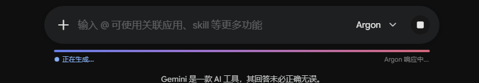
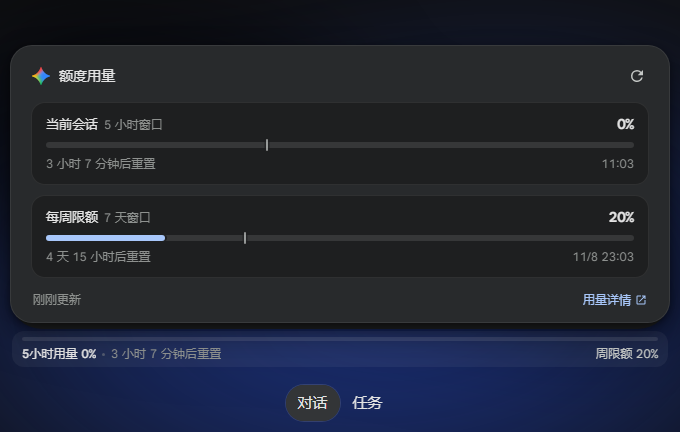

# Gemini Inline Usage Tracker

**优雅嵌入在 Google Gemini 输入框下方的原生风格额度使用监测条**

[功能特性](#-功能特性) • [实图展示](#-实图展示) • [安装与使用](#-安装与使用) • [配置与高级特性](#-配置与高级特性) • [开源协议](#-开源协议)

---

## 📸 实图展示

### 1. 待机状态（原生紧凑嵌入）
紧贴在输入胶囊正下方，展示当前 5 小时用量百分比、重置倒计时与每周限额。风格自适应深色与浅色模式。

### 2. 回答生成中（极光流光 + 实时耗时与字数）
当 Gemini 开始流式输出时，进度条自动切换为标志性的 Aurora 流光渐变波浪动画，实时更新生成耗时与当前响应字数。生成结束后自动同步并显示本次会话消耗变化。

### 3. 悬停展开面板（等宽通栏详情卡片）
鼠标悬停或点击即可展开通栏卡片，查看双维度（5 小时会话窗口 + 7 天周限额）用量指标、进度条步调标尺（预计消耗节奏）、精确重置时间戳及快捷刷新。

---

## ✨ 功能特性

- 🎨 **极简原生质感 (Native Look & Feel)**
  - 严格贴合 Google Gemini Material Design 3 规范与圆角系统。
  - 支持清晰字形抗锯齿与渲染优化，杜绝高分屏 / Windows DPI 缩放下的模糊毛边。
  - 自动识别并响应系统或页面的 Dark / Light 主题切换。

- ⚡ **全生命周期生成监控 (Live Streaming Feedback)**
  - 捕捉回答生成起始与结束状态。
  - 流式生成期间展示绚丽的 Gemini Aurora 动态渐变波浪动画。
  - 毫秒级时钟实时统计本次回答耗时（`正在生成 12s`）与文字字数输出。
  - 回答完毕后自动触发后台静默重试同步，精准计算本次回答消耗（如 `本次消耗 +3%`）。

- 📊 **双维度限额与重置追踪 (Dual-Quota Monitoring)**
  - **当前会话（5 小时窗口）**：精确捕获当前时段限额、剩余可用比例与重置倒计时。
  - **每周限额（7 天窗口）**：长周期消耗状况一目了然。
  - **步调标尺（Pacing Predictor）**：在卡片进度槽内嵌时间流逝标记（Tick），若消耗增速远超时间进度，将显示智能警示。

- 👥 **多账号隔离与免费层兼容 (Multi-Account & Free Tier)**
  - 深度感知 Google 账号切换（自动识别 `/u/0`、`/u/1`、`/u/2` 路由与对应账户）。
  - 各账号独立数据隔离与专属缓存，切换账号即刻刷新对应额度，无串号混淆。
  - 智能兼容 Free 免费账户，优雅显示动态配额分配状态。

- 🌏 **UTC+8 与本地时区自动纠偏**
  - 拦截并修复官方配额横幅可能存在的跨时区解析偏差，确保倒计时与时间戳精确对齐。

---

## 🚀 安装与使用

### 第一步：安装用户脚本管理器扩展
请确保您的浏览器已安装以下任一常用脚本管理器：
- [Tampermonkey (篡改猴)](https://www.tampermonkey.net/)（推荐）
- [Violentmonkey (暴力猴)](https://violentmonkey.github.io/)
- [ScriptCat (脚本猫)](https://scriptcat.org/)

### 第二步：安装脚本
你可以通过以下任意一种方式安装：
- **方式 A（推荐，一键安装）**：点击 [👉 一键安装脚本](https://raw.githubusercontent.com/Noctyn/gemini-inline-usage-tracker/main/gemini-usage-tracker.user.js)，已安装脚本管理器的浏览器会自动弹出安装确认页面。
- **方式 B（手动复制）**：在脚本管理器中新建脚本，将本仓库 [`gemini-usage-tracker.user.js`](./gemini-usage-tracker.user.js) 代码全文复制并粘贴保存。

安装完成后，打开或刷新 [Google Gemini](https://gemini.google.com/app)，输入框下方即可无缝显示用量监测条。

---

## ⚙️ 配置与高级特性

脚本内置了防抖与性能保护机制：
- **智能轮询**：窗口可见时每 60 秒静默更新，离开页面自动休眠。
- **悬停刷新门限**：悬停防抖 120ms，展开后距上次请求超 30 秒才触发更新，避免频繁请求触发速率限制。
- **无障碍支持**：进度条附带完整 WAI-ARIA `progressbar` 与实时读屏无障碍属性。

---

## 📄 开源协议

本项目基于 [GNU General Public License v3.0](LICENSE) 开源发布。
