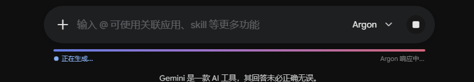
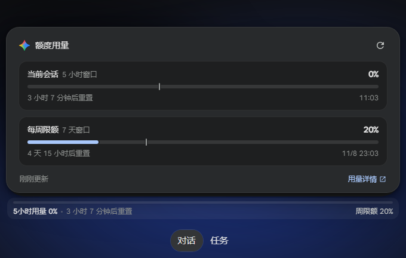

# Gemini Inline Usage Tracker

[English](README.md) | [简体中文](README.zh-CN.md)

**在 Google Gemini 输入框下方直接显示额度用量与重置倒计时**

[预览](#-预览) • [主要功能](#-主要功能) • [安装](#-安装) • [细节说明](#-细节说明) • [开源协议](#-开源协议)

---

## 📸 预览

### 1. 默认状态
紧贴输入框底部，直接显示 5 小时窗口用量、重置倒计时与周限额。随网页自动切换深浅色主题。

  

    
  

### 2. 生成状态
Gemini 输出回答时，进度条会切换为流光动画，并实时统计耗时与输出字数。回答结束后自动同步额度，显示单次对话的消耗量（如 `+3%`）。

  

    
  

### 3. 详情面板
鼠标悬停或点击可展开详情卡片，查看 5 小时窗口与 7 天周限额的具体数据、消耗进度参考线、准确重置时间，支持手动刷新。

  

    
  

---

## ✨ 主要功能

- **贴合原生 UI**
  - 沿用 Gemini 的 Material Design 3 配色与圆角设计，不像外挂插件。
  - 针对高分屏和 Windows 缩放做了字体抗锯齿优化，边缘不发虚。
  - 自动跟随系统或网页的深色/浅色模式。

- **生成耗时与单次消耗统计**
  - 流式输出期间显示动态波浪动画，实时计算生成耗时（如 `正在生成 12s`）和当前字数。
  - 生成结束后在后台静默同步最新配额，直接算出刚才那条回答花了多少额度。

- **双维度额度追踪**
  - 同时监控 **5 小时短期窗口** 和 **7 天长周期** 的限额与重置时间。
  - **消耗节奏参考线（Tick）**：在进度条上标出当前时间本该走到哪个位置。如果额度消耗速度明显快于时间流逝，会给出提示。

- **多账号防串号 & 免费版兼容**
  - 支持 `/u/0`、`/u/1` 等多账号路由切换。不同账号的缓存独立存放，切号立即刷新，数据不会互相污染。
  - 兼容 Free 免费账号的动态配额显示。

- **时区修正**
  - 修复了官方配额提示偶尔出现的跨时区解析错误，倒计时和本地时间完全对齐。

---

## 🚀 安装

1. 确保浏览器已安装脚本管理器：[Tampermonkey](https://www.tampermonkey.net/)、[Violentmonkey](https://violentmonkey.github.io/) 或 [ScriptCat](https://scriptcat.org/)。
2. 通过 **[Greasy Fork](https://greasyfork.org/zh-CN/scripts/603683-gemini-inline-usage-tracker)** 安装，或点击 **[👉 一键安装脚本](https://raw.githubusercontent.com/Noctyn/gemini-inline-usage-tracker/main/gemini-usage-tracker.user.js)** 确认安装（也可复制 [`gemini-usage-tracker.user.js`](./gemini-usage-tracker.user.js) 手动导入）。
3. 刷新 [Google Gemini](https://gemini.google.com/app) 页面即可看到底部的监测条。

---

## ⚙️ 细节说明

为了避免频繁请求被 Google 限制，脚本做了基本的防抖与节流处理：
- **后台轮询**：仅在页面处于激活状态时每 60 秒静默更新一次，切到后台自动暂停。
- **悬停限流**：鼠标悬停包含 120ms 防抖；展开面板时，如果距离上次请求不足 30 秒则直接读取缓存，不重复发包。
- **无障碍（a11y）**：包含完整的 WAI-ARIA `progressbar` 属性，支持读屏软件。

---

## 📄 开源协议

[GPL-3.0](LICENSE)
